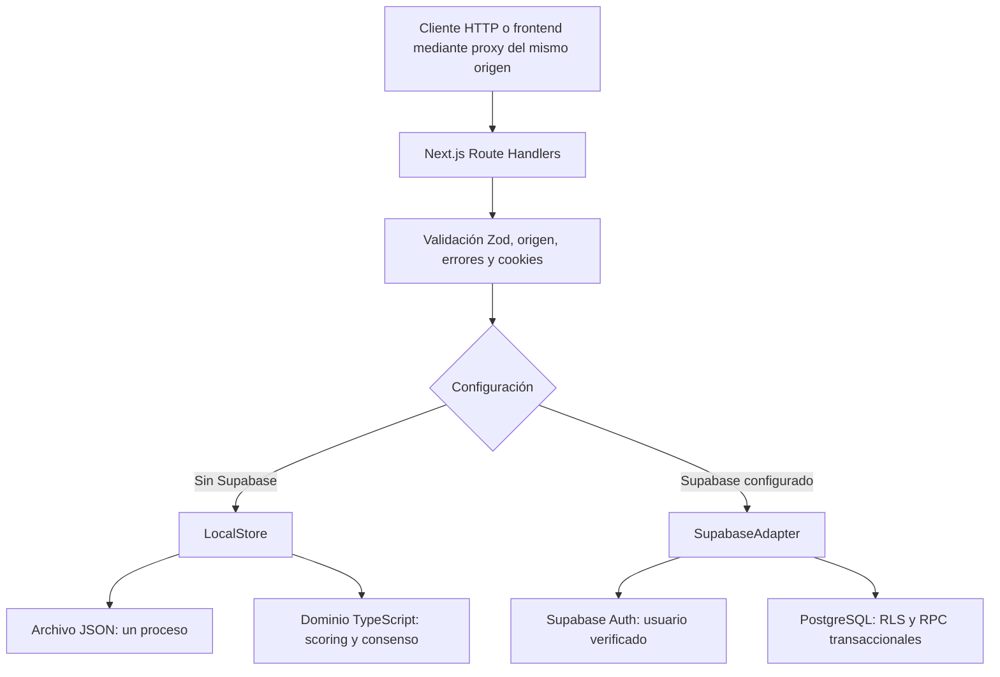

# Forecast League Backend

API independiente para una plataforma social de pronósticos probabilísticos: usuarios, preguntas, revisiones, consenso, precisión y ligas privadas. **Sin apuestas, dinero ni contratos negociables.**

Extraído de [Forecast League](https://github.com/Agusgal/Forecast-League), commit [`57751f6`](https://github.com/Agusgal/Forecast-League/commit/57751f690e50c077d145d2a3a5c2ba7df7f844aa). Este repositorio tiene su propio servidor, dependencias, historial Git, pruebas y datos locales. No necesitas clonar el proyecto original ni ejecutar su interfaz.

## Qué incluye y qué cambió al separarlo

Se conservaron el dominio TypeScript, validaciones Zod, rutas de API, sesiones, autenticación local, adaptador Supabase, migración PostgreSQL, seed y pruebas del backend. 

Se excluyeron pantallas, componentes, estilos, gráficos, iconos, cuentas personales, sesiones existentes y archivos de configuración privados. Las dependencias visuales fueron retiradas y el lockfile se regeneró. No se importó la base local de la aplicación original.

Next.js sigue siendo el servidor HTTP mediante **Route Handlers**, sin páginas de producto. React y React DOM permanecen como dependencias del framework; no hay componentes React propios ni frontend en este repo. Mantener el transporte original limita cambios en autenticación, cookies y contratos durante la extracción.

Cambios específicos de esta versión:

- `GET /` devuelve identificación y estado del proceso en JSON, sin crear una sesión. No comprueba la salud de la base de datos.
- `/auth/callback` devuelve JSON y cookies al confirmar el correo, en vez de redirigir a `/forecasts` o `/login`, pantallas que no existen aquí.
- Desarrollo y producción escuchan por defecto en `127.0.0.1:3002`, para convivir con la aplicación original.
- La cookie demo se llama `forecast_backend_session`, para no colisionar con la sesión local del frontend original: las cookies de un mismo host se comparten entre puertos.
- Se agregaron pruebas del servicio independiente y un recorrido HTTP reproducible.

## Ejecutar sin credenciales

Requisitos: **Node.js 20.9 o superior** y **pnpm**. Las versiones de las dependencias están fijadas en `package.json` y `pnpm-lock.yaml`.

```sh
git clone https://github.com/Agusgal/Forecast-League-backend.git
cd Forecast-League-backend
pnpm install --frozen-lockfile
pnpm dev
```

```sh
curl http://127.0.0.1:3002/
curl http://127.0.0.1:3002/api/auth
```

Sin variables Supabase se activa el modo demo. `GET /api/auth` consulta la sesión sin crear una; `GET /api/bootstrap` crea un invitado y los datos de ejemplo cuando hacen falta.

```sh
curl -c /tmp/forecast-backend.cookies http://127.0.0.1:3002/api/bootstrap
```

Copiá el `id` de una pregunta publicada cuyo plazo esté abierto y enviá un pronóstico con la misma cookie:

```sh
curl -b /tmp/forecast-backend.cookies \
  -H 'Content-Type: application/json' \
  -d '{"questionId":"ID_DE_PREGUNTA_ABIERTA","probability":0.73,"reasoning":"Mi estimación inicial"}' \
  http://127.0.0.1:3002/api/forecasts
```

Las probabilidades son **fracciones**: `0.73` significa 73 %. Conservá la cookie para revisar el pronóstico y consultar el consenso. El archivo de cookies es una credencial local: no lo agregues al repositorio.

Para una comprobación automatizada contra una demo local en ejecución:

```sh
node scripts/smoke.mjs
```

Este script crea un invitado y dos revisiones. Solo admite direcciones loopback y comprueba que el servidor esté en modo demo antes de crear datos. `FORECAST_API_URL` permite elegir otro puerto local.

## Arquitectura



| Capa | Archivos | Responsabilidad |
| --- | --- | --- |
| Transporte | `src/app/api/**/route.ts` | Contratos HTTP, selección de adaptador y respuestas |
| Confirmación | `src/app/auth/callback/route.ts` | Intercambio de código PKCE o verificación de token de correo |
| Límite HTTP | `src/server/http.ts` | Origen, JSON, validación, errores y cabeceras privadas |
| Dominio | `src/domain/types.ts`, `schemas.ts`, `scoring.ts` | Modelos, invariantes de entrada, Brier, rankings, calibración y consenso |
| Persistencia local | `src/server/local-store.ts` | Sesiones, cuentas, revisiones, ligas y ciclo de preguntas en archivo |
| Integración remota | `src/server/supabase.ts` | Autenticación verificada, consultas y RPC con el token del usuario |
| Cookies | `src/server/response-cookies.ts` | Propagar renovaciones de sesión incluso cuando falla una operación posterior |
| Ejemplos | `src/domain/seed.ts`, `argentina-examples.ts` | Fixtures simulados con plazos fijados al crearlos |
| Localización | `src/lib/locale.ts`, `src/server/demo-content.ts` | Errores en español y actualización aditiva de datos demo |
| Base de datos | `supabase/migrations`, `supabase/seed.sql` | Esquema, índices, restricciones, RLS, funciones y preguntas simuladas |
| Verificación | `tests`, `supabase/tests`, `scripts/smoke.mjs` | Dominio, API, persistencia, SQL y recorrido HTTP |

El dominio no importa Next.js ni React. La persistencia local y la remota son implementaciones diferentes; las rutas seleccionan explícitamente una. Las reglas críticas también se aplican en PostgreSQL para que una solicitud directa a su API no pueda eludirlas. No se usa una clave privilegiada para escribir datos de otros usuarios.

### Una predicción de punta a punta

1. La ruta comprueba el origen y `Content-Type`, analiza JSON y valida campos mediante Zod.
2. El adaptador identifica al usuario por su sesión. El cuerpo no puede elegir propietario, fecha, revisión ni puntaje.
3. Se comprueba que la pregunta esté publicada, abierta y estrictamente antes del cierre.
4. Se actualiza el pronóstico actual y se agrega una revisión inmutable.
5. La respuesta contiene el pronóstico persistido. El siguiente bootstrap revela el consenso de esa pregunta para ese usuario.
6. Al resolver, se puntúa la última revisión válida anterior al cierre y se conserva el resultado final.

### Datos y concurrencia

PostgreSQL contiene `profiles`, `questions`, `forecasts`, `forecast_revisions`, `question_resolutions`, `scores`, `leagues`, `league_members`, `competitions` y `competition_questions`. Supabase administra la identidad en `auth.users`.

`forecasts` representa el estado actual; `forecast_revisions`, el historial. Las funciones de envío y resolución bloquean la pregunta dentro de una transacción. Las restricciones de unicidad evitan puntajes duplicados y membresías repetidas.

En demo, `.data/forecast-league.json` contiene el conjunto local. `LocalStore` serializa operaciones en un proceso y reemplaza el archivo de forma atómica. **No coordina varios procesos ni instancias serverless.** Los reinicios preservan datos y plazos. `FORECAST_DATA_PATH` permite elegir un archivo independiente; no apuntes al de la aplicación original si querés mantener separados los entornos.

### Ciclo y puntajes

```text
DRAFT → PUBLISHED → CLOSED → RESOLVED
                    salidas alternativas: VOID / CANCELLED
Brier = (p − resultado)², donde resultado ∈ {0, 1}
puntos = round(1000 × (1 − promedio de Brier))
```

Los criterios, fuente y fechas quedan congelados al publicar. La resolución requiere cerrar primero y no puede reescribirse. Preguntas abiertas, anuladas o canceladas no aumentan la precisión final. La última revisión se selecciona **estrictamente antes del cierre**, usando tiempo del servidor o la base de datos.

Los puntos representan precisión provisional, no dinero ni un rating de habilidad validado. El volumen no agrega puntos. Los rankings globales son exploratorios porque sus participantes pueden responder preguntas distintas. Las ligas comparan preguntas resueltas que respondieron todos sus integrantes actuales, dentro de la semana o mes UTC. Incorporar un integrante puede cambiar esa muestra.

## API

Las mutaciones usan JSON y sesión por cookie. Las entradas rechazan campos desconocidos. Los errores de las rutas envueltas en `endpoint` tienen forma `{ "error": "Explicación" }`; las respuestas de esas rutas llevan `Cache-Control: private, no-store` y `Vary: Cookie`. Los códigos incluyen 400, 401, 403, 404, 409, 413, 415, 429 y 503 según la condición.

| Método y ruta | Entrada o resultado |
| --- | --- |
| `GET /` | Identificación y estado del proceso, sin probar almacenamiento |
| `GET /api/auth` | `{ mode, user }`, sin crear invitado |
| `POST /api/auth` | `signup`, `login` o `logout` |
| `GET /auth/callback` | `code` PKCE o `token_hash` con `type=email`; devuelve JSON y cookies |
| `GET /api/bootstrap` | Modo, perfil actual, preguntas, pronósticos propios, consenso habilitado, ligas, ranking y estadísticas |
| `POST /api/forecasts` | `{ questionId, probability, reasoning? }` → `{ forecast }` |
| `POST /api/profile` | `{ username, country }` → `{ user }` |
| `POST /api/leagues` | `{ name, description?, period?: "weekly" \| "monthly" }` → `{ league }` |
| `POST /api/leagues/join` | `{ code }` → `{ league }` |
| `GET /api/admin/questions` | Conteos de participantes y revisiones; solo administrador |
| `POST /api/admin/questions` | Crear/editar borrador o ejecutar una transición; solo administrador |

Registro: `{ "action": "signup", "email": "...", "password": "...", "username": "..." }`. Contraseña de registro: 8–128 caracteres. Inicio de sesión: `{ "action": "login", "email": "...", "password": "..." }`. Salida: `{ "action": "logout" }`.

La administración acepta `{ action: "create", question }`, `{ action: "update", questionId, question }` o `{ action, questionId, outcome? }`. Las transiciones son `publish`, `close`, `resolve`, `void` y `cancel`; solo `resolve` recibe `outcome` 0 o 1. El borrador completo se define en [schemas.ts](src/domain/schemas.ts), incluyendo criterios, fuente y fechas ISO 8601. Los contratos de salida están en [types.ts](src/domain/types.ts).

El bootstrap nunca entrega los pronósticos individuales ni razonamientos de otras personas. Antes de responder, el consenso es `null`, incluyendo su cantidad de participantes. La auditoría administrativa expone conteos agregados.

## Autenticación y conexión de clientes

**Demo:** invitados con sesión opaca, cookies HttpOnly/SameSite y token almacenado como hash. El registro conserva los pronósticos del invitado, guarda la contraseña con salt y scrypt y rota la sesión. Los correos no se verifican ni envían. Existe un límite de diez intentos de autenticación por cuenta y minuto, en memoria del proceso.

**Todos los perfiles de la demo son administradores** para poder explorar el ciclo completo. Usala solo en un entorno local o de confianza. No es el backend para un servicio público.

**Supabase:** cookies de autenticación en el servidor, verificación del usuario mediante `getUser()`, token del usuario en consultas y permisos RLS/RPC en la base de datos. En producción las cookies requieren HTTPS. El prefijo `NEXT_PUBLIC_` se conserva por compatibilidad con la extracción; sus valores son una URL y una clave pública, nunca `service_role` o una clave secreta.

## Configurar Supabase

```sh
cp .env.example .env.local
```

```dotenv
NEXT_PUBLIC_SUPABASE_URL=https://tu-proyecto.supabase.co
NEXT_PUBLIC_SUPABASE_ANON_KEY=tu-clave-publica-anon-o-publishable
```

Seguí [supabase/README.md](supabase/README.md) para migración, seed, permisos y asignación administrativa. Aplicá la migración inicial a un proyecto nuevo una vez. El seed contiene quince preguntas simuladas en español, sin inventar usuarios ni pronósticos; volver a ejecutarlo no modifica preguntas publicadas. Los datos locales no se importan automáticamente.

Ambas variables vacías activan demo. Una configuración parcial, inválida o con clave privilegiada se rechaza, sin volver silenciosamente al modo local. Reiniciá el servidor después de cambiar variables.

No se suministró ni verificó un proyecto Supabase alojado. Las pruebas de transporte usan mocks; el harness SQL ejecuta PostgreSQL en PGlite con roles de prueba. Autenticación real, correo, PostgREST, proxy y configuración de producción deben verificarse en el entorno de destino.

## Prompts y proceso para llegar a esta versión

El código proviene de una conversación iterativa con Codex. El usuario definió visión, restricciones y correcciones; el asistente implementó, ejecutó pruebas y adaptó el resultado. No se generó todo con un único prompt. Esta sección describe el proceso; [docs/PROMPTS.md](docs/PROMPTS.md) incluye una secuencia de prompts reconstruidos y reutilizables.

### Brief inicial

El pedido asignó un rol de socio técnico, desarrollador full stack, diseñador y arquitecto. Después fijó la visión, el stack y las invariantes: sin apuestas, datos ficticios identificados, dominio reutilizable para futuros clientes, RLS, historial auditable y Brier score. Exigió implementación inmediata después de inspeccionar y planificar brevemente.

El recorrido mínimo literal fue:

> Home Feed → Question Detail → Probability Selection → Forecast Submission → Database Persistence → Confirmation.

Para el backend, eso se tradujo en sesión → validar probabilidad/plazo → persistir una revisión → responder → habilitar consenso. Luego se incorporaron puntajes, administración y ligas.

### Iteraciones que explican el backend actual

| Pedido o etapa | Decisión resultante |
| --- | --- |
| Reglas explícitas del brief | Brier centralizado, última revisión válida, criterios congelados y RLS |
| Trabajar aunque faltaran credenciales | Modo local persistente y adaptador Supabase, con límites documentados |
| Preguntas sobre 50 % y puntajes | Distinción entre precisión, puntos derivados y ranking provisional |
| Verificar registro e inicio de sesión | Cuentas locales con contraseñas hasheadas, continuidad del invitado y sesiones rotadas |
| “Quiero que traduzcas al español todo, y agrega predicciones ejemplo relevantes para argentina.” | Errores en español, fixtures argentinos y migración aditiva del contenido demo |
| Extraer solo el backend a otro repo | Dependencias reducidas, servicio JSON, callback sin pantallas y verificación independiente |

Las decisiones visuales del proyecto original no se copiaron. Los campos de contrato como `visual` y `avatarColor` sí se conservan para compatibilidad con clientes; no incluyen implementación de interfaz.


```

